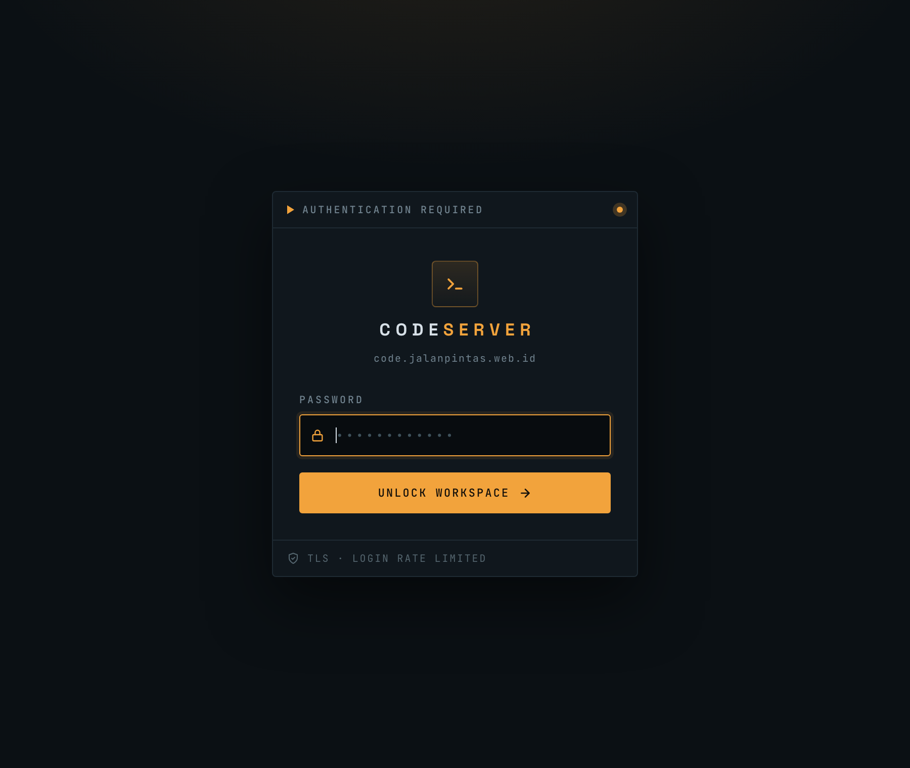

# code-server-vps

[code-server](https://github.com/coder/code-server) behind nginx on a small VPS,
with a login page restyled in the [pingwin](https://github.com/ekomardiatno) design
language — dark ink, transmission amber, and a three-voice type system.



Everything here is the actual deployed configuration for
`code.jalanpintas.web.id`, kept in git so a rebuild is a checkout rather than
archaeology.

---

## Why this exists

code-server renders its login and error pages from plain files inside its own
install tree. That makes them trivial to restyle — and means **`dpkg -i` of a new
code-server release silently reverts the lot**. So the theme needs a home outside
the install tree and a one-command way back in. That is `apply.sh`.

---

## Layout

```
theme/          login + error pages, favicon, and the three self-hosted fonts
nginx/          the vhost, the websocket map, and the proxy/header snippets
systemd/        memory caps for the code-server unit
config.yaml.example
apply.sh        re-install the theme after a code-server upgrade
```

`nginx/` and `systemd/` are one-time setup, so `apply.sh` deliberately does not
touch them — it only handles the part an upgrade destroys. They are kept here as
the source of truth; if you edit them on the box, copy the change back.

---

## The theme

A single 360px panel: mono title bar with a live beacon, a `>_` brand mark, the
wordmark, one field, one button, and a footer stating what protects the session.

| | |
|---|---|
| Background | `#0b1014` with a single amber bloom off the top edge |
| Panel | `#10171d`, 1px `#1e2a33`, 4px radius |
| Accent | `#f2a33c` |
| Display | Space Grotesk — the wordmark |
| Body | Manrope — prose |
| Mono | JetBrains Mono — **anything the machine owns**: labels, buttons, hostnames |

Icons are inline stroke SVG on a 24-unit grid using `currentColor`, so they
inherit the colour of whatever contains them. No icon font, no emoji.

### Three constraints worth knowing before editing

**1. The pages ship a strict CSP.** `style-src 'self'` means no inline `<style>`
and no `style=""` attributes — all CSS must live in the linked files. Inline
`<svg>` is fine. `url("data:image/svg+xml,…")` inside CSS is fine, because that
falls under `img-src 'self' data:`; the error icon is a CSS `mask` so it tracks
`currentColor`.

**2. Fonts are referenced relatively** (`./manrope.woff2`) from `global.css`, and
deploy flat beside it. That is what lets the theme survive any `{{CS_STATIC_BASE}}`
or `--abs-proxy-base-path` change without rewriting URLs. The repo keeps them in
`theme/fonts/` purely for tidiness; `apply.sh` flattens them.

**3. Some `{{PLACEHOLDERS}}` are load-bearing.** code-server fills these at render
time:

| Placeholder | Keep? | Why |
|---|---|---|
| `{{BASE}}` | **required** | hidden input; cookies must be set on an absolute path |
| `{{ERROR}}` | **required** | replaced by `<div class="error">…</div>`; drop it and a wrong password looks like a no-op |
| `{{CS_STATIC_BASE}}` | **required** | asset prefix |
| `{{OPTIONS}}` | **required** | client settings blob |
| `{{I18N_*}}`, `{{WELCOME_TEXT}}`, `{{PASSWORD_MSG}}` | dropped | replaced with hardcoded English. The substitutions are plain `.replace` calls, so unused ones are harmless |

CI asserts the required four, plus `name="password"` and `method="post"`.

### Fonts

Taken from the pingwin sources, subset to Latin and converted to woff2 —
**488 KB of TTF down to 84 KB**, variable `wght` axes intact:

```bash
pyftsubset manrope.ttf \
  --unicodes="U+0020-007E,U+00A0-00FF,U+2010-2015,U+2018-201F,U+2022,U+2026,U+2030,U+2039-203A,U+20AC,U+2122,U+2192,U+25B8" \
  --layout-features="kern,liga,calt,tnum" \
  --flavor=woff2 --output-file=manrope.woff2
```

`fonttools` needs the `brotli` package for woff2 output. All three faces are
SIL OFL 1.1 — see [NOTICE](NOTICE).

---

## Setting it up on a fresh box

Assumes Ubuntu with nginx and certbot already fronting the host, and a DNS A
record for your subdomain pointing at it.

**1. Swap, if the box is small.** An editor's extension host plus a TS language
server will outgrow a 4 GB box, and with no swap the kernel OOM-killer picks its
own victim — often something else entirely.

```bash
sudo fallocate -l 2G /swapfile && sudo chmod 600 /swapfile
sudo mkswap /swapfile && sudo swapon /swapfile
echo '/swapfile none swap sw 0 0' | sudo tee -a /etc/fstab
printf 'vm.swappiness=10\n' | sudo tee /etc/sysctl.d/99-swappiness.conf
sudo sysctl --system
```

`swappiness=10` keeps swap as a safety net rather than something the kernel
reaches for routinely.

**2. code-server.** There is no distro package; use the official installer.

```bash
curl -fsSL https://code-server.dev/install.sh | sh
```

**3. Config.** Copy `config.yaml.example` to `~/.config/code-server/config.yaml`,
`chmod 600`, and fill in your own hash (instructions are in the file).

**4. Memory caps.**

```bash
sudo mkdir -p /etc/systemd/system/code-server@.service.d
sudo cp systemd/override.conf /etc/systemd/system/code-server@.service.d/
sudo systemctl daemon-reload
sudo systemctl enable --now code-server@"$USER"
curl -I http://127.0.0.1:8093          # expect 302 -> ./login
```

`MemoryHigh`/`MemoryMax` are scoped to the unit, so a runaway editor is killed in
its own cgroup instead of letting the kernel choose.

**5. nginx.** The vhost is written in two stages on purpose. A `listen 443 ssl`
block whose certificate is not yet on disk fails `nginx -t`, and **a failed test
means nginx will not reload at all** — every other site keeps serving the last
good config while your next legitimate change silently does nothing.

```bash
sudo cp nginx/conf.d/websocket-upgrade.conf /etc/nginx/conf.d/
sudo cp nginx/snippets/*.conf /etc/nginx/snippets/

# Stage 1: HTTP only, so certbot's HTTP-01 challenge can be answered.
printf 'server {\n  listen 80;\n  server_name %s;\n  location / { return 301 https://$host$request_uri; }\n}\n' \
  code.jalanpintas.web.id | sudo tee /etc/nginx/sites-available/code.jalanpintas.web.id
sudo ln -s /etc/nginx/sites-available/code.jalanpintas.web.id /etc/nginx/sites-enabled/
sudo nginx -t && sudo systemctl reload nginx

sudo certbot certonly --nginx -d code.jalanpintas.web.id

# Stage 2: the real thing.
sudo cp nginx/code.jalanpintas.web.id.conf /etc/nginx/sites-available/code.jalanpintas.web.id
sudo nginx -t && sudo systemctl reload nginx
```

**6. Theme.**

```bash
./apply.sh
```

**7. Firewall.** `8093` is bound to loopback so it was never reachable, but an
explicit deny documents the intent:

```bash
sudo ufw deny 8093/tcp comment 'code-server - nginx proxies via lo'
```

### Two nginx details that are easy to get wrong

**The websocket map is not optional.** code-server is websocket-first; without a
working `Upgrade`/`Connection` pass-through the editor is a permanent spinner
with no error anywhere. `conf.d/websocket-upgrade.conf` sets `Connection` from a
`map` on `$http_upgrade` rather than hardcoding `"upgrade"`, because hardcoding
it breaks keepalive on ordinary HTTP requests.

**`add_header` is not additive across levels.** A single `add_header` inside a
`location` replaces the *entire* inherited set. `location = /login` adds
`X-Robots-Tag`, so it has to re-include the security headers or it silently
serves without `nosniff`, HSTS and `Referrer-Policy`.

---

## Deploying a change

Publishing a release runs the CI and rsyncs to the host:

```bash
gh release create v1.0.1 --generate-notes
```

Or `gh workflow run "CI & deploy"`. Pull requests run the checks only — the
deploy job has no `pull_request` trigger, deliberately, because this repo is
public and the deploy key reaches a host with passwordless sudo.

Required secrets: `DEPLOY_KEY`, `DEPLOY_HOST`, `DEPLOY_USER`, `DEPLOY_KNOWN_HOSTS`.
Optional variable: `DEPLOY_URL` (defaults to `https://code.jalanpintas.web.id`).

To re-apply by hand after a code-server upgrade:

```bash
cd ~/code-server-vps && git pull && ./apply.sh
```

No restart is needed — `login.html` is read from disk per request. Hard-reload
the browser if the old CSS is cached.

---

## Reverting

`apply.sh` keeps the genuine upstream files as `*.orig`, taken once on first run
and never overwritten:

```bash
cd /usr/lib/code-server/src/browser/pages
for f in global.css login.css login.html error.css; do sudo cp "$f.orig" "$f"; done
```

---

## Verifying

```bash
swapon --show                                   # 2 Gi
systemctl is-active code-server@"$USER"         # active
sudo ss -tlnp | grep 8093                       # 127.0.0.1 only
systemctl show code-server@"$USER" -p MemoryMax # 1258291200
curl -I https://code.jalanpintas.web.id         # 302 -> ./login, valid cert
```

The websocket path is the one thing a plain `curl -I` will not catch. Log in,
then:

```bash
curl -s -o /dev/null -w '%{http_code}\n' -b cookies.txt --http1.1 \
  -H 'Connection: Upgrade' -H 'Upgrade: websocket' \
  -H 'Sec-WebSocket-Version: 13' -H 'Sec-WebSocket-Key: dGhlIHNhbXBsZSBub25jZQ==' \
  'https://code.jalanpintas.web.id/?reconnectionToken=11111111-2222-3333-4444-555555555555&reconnection=false&skipWebSocketFrames=false'
```

`101` means the editor will load. Anything else means a spinner.

Note that code-server has its **own** login rate limiter (2/min, 12/hour) on top
of the nginx `cs_login` zone — worth remembering before testing wrong passwords.

---

## Licence

MIT — see [LICENSE](LICENSE). `theme/login.html` derives from code-server (MIT)
and the bundled fonts are SIL OFL 1.1; both are covered in [NOTICE](NOTICE).
